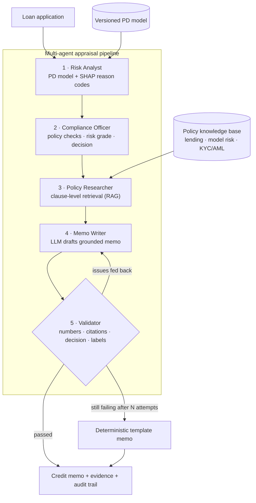

# CreditLens AI

**Explainable, policy-grounded credit appraisal with self-validating Generative AI credit memos.**


Banks spend hours per application writing credit memos: pulling the risk score, checking the
lending policy clause by clause, explaining the decision and documenting it for audit.
CreditLens AI automates that workflow with a multi-agent pipeline. The key design choice is that
**the GenAI writes and explains, but never decides**. Every generated memo is checked against the
system of record before anyone sees it.

| What a credit team gets | How |
|---|---|
| A probability of default with reason codes | ML model chosen from four candidates with stratified CV; SHAP attributions per applicant |
| An auditable decision | Deterministic policy engine (DTI, bureau score, delinquency, LTV, amount caps, KYC, AML) |
| Answers grounded in policy | Clause-level RAG over the bank's policy documents, with inline citations like `[RLP-2]` |
| A memo that a regulator would accept | LLM draft → validator → feedback loop → safe fallback; nothing unvalidated is ever shown |
| Freedom from vendor lock-in | Gemini, Azure OpenAI, OpenAI or an offline writer, chosen with one environment variable |

---

## Architecture



### The validator: guardrails for GenAI in a regulated process

Before a memo is accepted, `validator.py` checks that:

1. **Every number** (PD, DTI, income, EMI, thresholds) can be traced to the application facts or to the cited policy text. Invented figures are rejected.
2. **Every citation** refers to a clause that was actually retrieved as evidence. Invented references such as `[RBI-99]` are rejected.
3. **Every FAIL / REVIEW check** is discussed and cited.
4. **The recommendation matches** the policy engine's decision verbatim and does not contradict it.
5. **The memo is labelled** as an AI-generated draft for human review and contains all required sections.

If a draft fails, the issues go back to the LLM as feedback (self-correction). If it still fails
after the retry budget, the system falls back to a deterministic template that is itself
validated. Tests cover both paths with deliberately hallucinating LLM stubs.

---

## Results

Results on a 20,000-loan synthetic portfolio (8.1% default rate). Hold-out = 20% stratified split.

| Model | CV ROC-AUC (5-fold) | CV PR-AUC |
|---|---|---|
| **Logistic Regression** (selected) | **0.826 ± 0.012** | **0.405** |
| Random Forest | 0.822 ± 0.008 | 0.389 |
| Gradient Boosting | 0.820 ± 0.010 | 0.377 |
| XGBoost | 0.816 ± 0.011 | 0.385 |

Selected model hold-out ROC-AUC: **0.832**. Logistic regression wins because the remaining risk
signal is close to linear once DTI and LTV are engineered. This result is also the easiest one to
defend to a model risk committee: higher model complexity is not used when it does not pay off.

**Leakage audit.** The raw data includes `post_disbursal_collection_flag`, a field only known
after the loan is paid out. On its own it scores a single-feature ROC-AUC of about 0.91. The
audit flags it automatically and the pipeline drops it before training (policy MRM-4).

**End-to-end guardrail evaluation** (`python scripts/evaluate.py --n 100`, unseen applicants):

| Metric | Value |
|---|---|
| Memo validation pass rate | 100% |
| Flagged checks discussed with a citation | 100% |
| Decision mix (approve / refer / decline) | 51% / 21% / 28% |
| Mean pipeline latency (offline writer) | ~0.04 s |

> With a live LLM, also track the *first-attempt* pass rate and the *fallback* rate. They show how
> often the model needs correcting, which is a useful KPI when choosing between LLM providers.

---

## Quick start

```bash
git clone https://github.com/krupa22joshi/creditlens-ai.git
cd creditlens-ai
python -m venv .venv && source .venv/bin/activate   # Windows: .venv\Scripts\activate
pip install -r requirements-dev.txt

python scripts/train.py                 # trains and versions the PD model (~1 min)
streamlit run app/streamlit_app.py      # dashboard on http://localhost:8501
```

The app runs **with no API key** using the offline memo writer. To use a real LLM, copy
`.env.example` to `.env` and set one provider:

```bash
LLM_PROVIDER=gemini         GEMINI_API_KEY=...
LLM_PROVIDER=azure_openai   AZURE_OPENAI_ENDPOINT=...  AZURE_OPENAI_API_KEY=...  AZURE_OPENAI_DEPLOYMENT=...
LLM_PROVIDER=openai         OPENAI_API_KEY=...
```

### REST API

```bash
uvicorn creditlens.api:app --app-dir src --reload     # docs at http://localhost:8000/docs
```

| Method | Endpoint | Purpose |
|---|---|---|
| `POST` | `/assess` | Full appraisal: PD, grade, drivers, checks, clauses, memo, validation, trace |
| `GET` | `/policies/search?q=...` | Semantic search over policy clauses |
| `GET` | `/policies/{clause_id}` | Fetch a clause, e.g. `RLP-2` |
| `GET` | `/model/metrics` | Model card: comparison, hold-out scores, leakage audit |
| `GET` | `/health` | Model version and active LLM provider |

### Docker

```bash
docker compose up --build     # API on :8000, dashboard on :8501
```

### Tests and evaluation

```bash
pytest                                     # 19 tests: model, leakage, rules, RAG, guardrails, API
python scripts/evaluate.py --n 100         # end-to-end guardrail metrics -> artifacts/eval_report.json
```

CI (GitHub Actions) runs lint, the test suite, training and the guardrail evaluation on every push.

---

## Dashboard

* **Credit appraisal**: enter an application or load a sample. The page shows the decision, PD gauge, SHAP driver chart, the generated memo (downloadable), policy checks, retrieved evidence and the full agent audit trail.
* **Model governance**: model comparison, hold-out metrics and the leakage audit, acting as a lightweight model card.
* **Policy search**: ask questions of the policy knowledge base.

---

## Project structure

```
creditlens-ai/
├── app/streamlit_app.py        # dashboard
├── knowledge_base/             # policy documents (lending, model risk, KYC/AML), one clause per heading
├── scripts/
│   ├── train.py                # train + version the PD model
│   └── evaluate.py             # batch guardrail evaluation
├── src/creditlens/
│   ├── agents.py               # multi-agent pipeline and self-correction loop
│   ├── validator.py            # GenAI guardrails
│   ├── memo.py                 # system prompt, prompt builder, template memo
│   ├── llm.py                  # Gemini / Azure OpenAI / OpenAI / offline providers
│   ├── retriever.py            # clause-level RAG
│   ├── policy_rules.py         # deterministic policy engine and risk grading
│   ├── model.py                # leakage audit, model comparison, SHAP explanations
│   ├── features.py             # shared feature engineering
│   ├── data.py                 # synthetic portfolio generator and demo applicants
│   ├── schemas.py              # typed contracts (pydantic)
│   └── api.py                  # FastAPI service
└── tests/
```

---

## Design decisions

* **Decision and narration are separated.** Approve/refer/decline comes from transparent rules plus model grading, and the LLM only explains it. This keeps GenAI out of the approval path, which most model-risk and responsible-AI frameworks require.
* **Retrieval works at clause level, not page level.** Each chunk is one citable policy clause, so citations can be checked by a machine and audits are simple.
* **Clauses are retrieved two ways.** Clauses linked to triggered checks are always fetched by ID (reliable recall). Semantic search adds context for the applicant's top risk drivers.
* **The LLM layer has no vendor SDKs.** Providers are called over HTTPS, so moving a client from Gemini to Azure OpenAI is a configuration change, not a code change.
* **Synthetic data with real structure.** The generator encodes known credit-risk relationships, including nonlinear DTI payment shock and score × DTI interaction, plus a planted leakage column. The whole project can then be published and reproduced without customer data.
* **Explainability was chosen over raw complexity.** Features that duplicate DTI (EMI, loan amount, existing debt) are excluded so SHAP reason codes keep intuitive signs for credit officers.

## Roadmap

- [ ] Swap TF-IDF for a vector store (ChromaDB + sentence-transformers) behind the same retriever interface
- [ ] Fairness monitoring across segments (MRM-5) and drift alerts (MRM-6)
- [ ] Ingest real regulatory circulars (PDF) with clause-aware chunking
- [ ] LLM-as-judge scoring of memo readability alongside the rule-based validator

---

*The policy documents in `knowledge_base/` are illustrative policies for a fictional bank, written
for this project. They are not official regulatory text. All applicant data is synthetic.*

**Author:** Krupa Joshi · [LinkedIn](https://linkedin.com/in/krupa-joshi-99b832287) · [GitHub](https://github.com/krupa22joshi)
